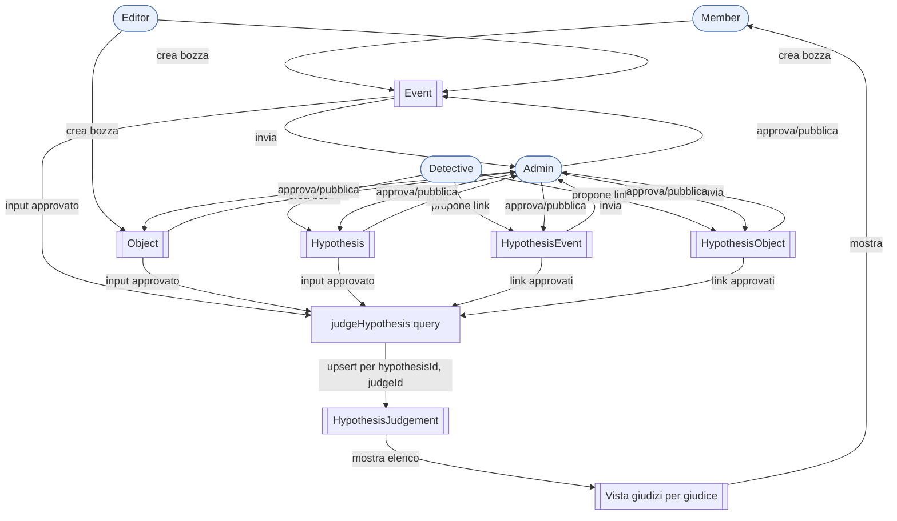
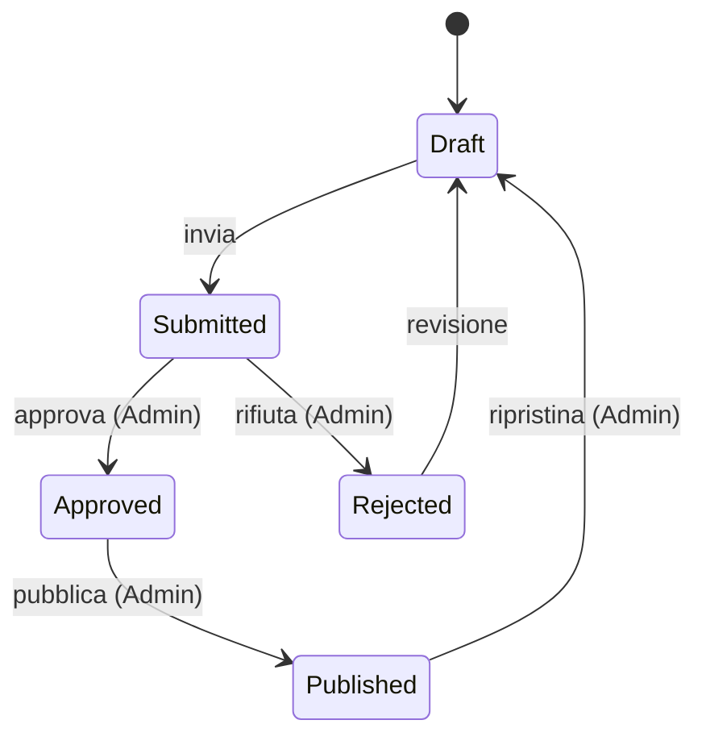
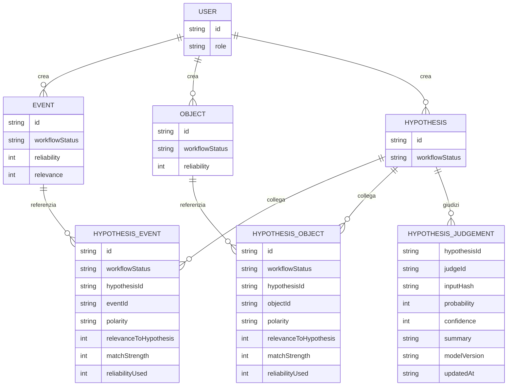
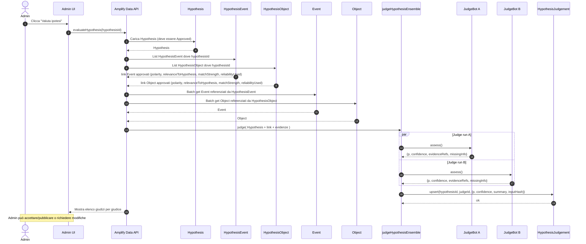
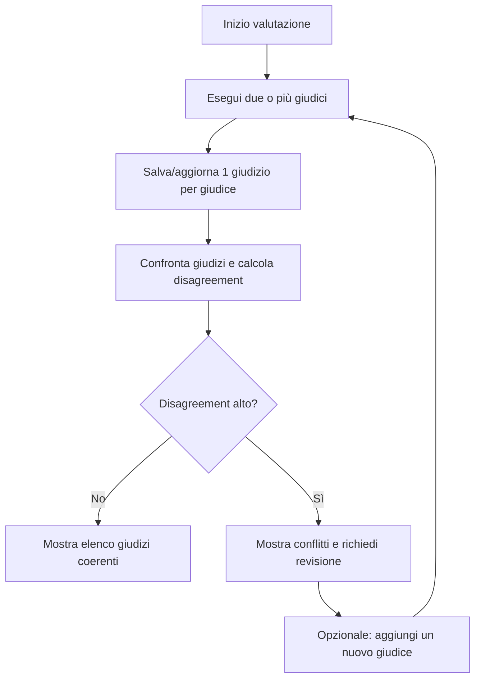

# Workflow delle ipotesi e pipeline di valutazione

Questo documento descrive un workflow **curato** per **Event**, **Hypothesis** e
i rispettivi collegamenti di evidenza (**HypothesisEvent** e **HypothesisObject**),
dove **solo l'Admin può pubblicare**.

La valutazione di una Hypothesis produce **giudizi separati per ogni giudice**
(es. `bot-1`, `bayes-1`). Non esiste (per ora) un singolo numero “universale”
che vince sugli altri.

## Workflow end-to-end (ruoli, approvazione, valutazione)

\* `judgeHypothesis` è mostrata come query (stateless). In pratica puoi anche
aggiungere una mutation tipo `applyJudgement` per persistere uno snapshot
"ufficiale", ma l'idea chiave è: **i bot non pubblicano; pubblica l'Admin**.

## Macchina a stati di approvazione

### Hypothesis

## Bozza modello dati (ER concettuale)

Questa è una vista concettuale delle entità e delle loro relazioni. Non impone
una specifica forma di schema Amplify (puoi comunque denormalizzare campi sui
modelli di join per ridurre le letture).

## Processo di valutazione (judging, aggiornamento giudizi per giudice)

Questo diagramma mostra come una ipotesi approvata viene valutata usando link
`HypothesisEvent` / `HypothesisObject` approvati, con uno o più judge.

### Gestione del disaccordo (consigliata)

